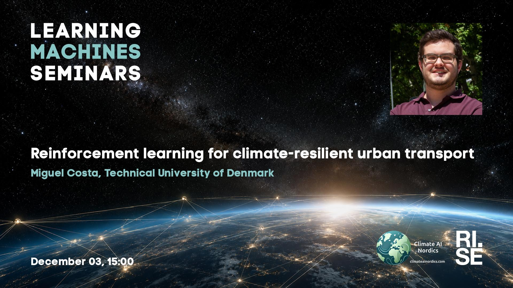

 
Welcome to this week's Learning Machines seminar.

This seminar is a collaboration between RISE and Climate AI Nordics -- [climateainordics.com](https://climateainordics.com/).

**Title:** Learning when and where to adapt: Reinforcement learning for climate-resilient urban transport

**Speaker:** Miguel Costa, Technical University of Denmark

**Abstract:** Cities need to decide now which climate adaptation measures to build, where to put them, and when, while facing deep uncertainty about how the climate will change over the coming decades. Each investment will last for a few decades and will be costly. Their impacts and benefits can also play out through coupled systems, such as, rainfall drives flooding, flooding disrupts how people move around the city, creating economic and wellbeing impacts. Classical optimisation methods struggle at the city-scale over a planning horizon of 75 years or more.
In this talk, I will present a decision-support framework which can address this problem by embedding an integrated assessment model inside a reinforcement learning (RL) loop. The model chains climate projections, a flood model, a transport simulation and an assessment of direct and indirect impacts. A graph neural network policy learns adaptation pathways from this model: it decides per zone and per year which nature-based and grey measures to deploy, balancing investment and maintenance costs against avoided damage, travel delays and cancelled trips.
On a full-city case study of pluvial flooding in Copenhagen (278 zones, 2025–2100, 42 scenarios from EURO-CORDEX), RL cuts total costs by about 25% compared with doing nothing and outperforms competing alternatives across two case studies (Bayesian optimisation, CMA-ES, trigger rules, Copenhagen’s own Cloudburst Plan design standard, and Direct Policy Search). Results hold across scenarios, including on held-out climate trajectories. I will then discuss how such a framework can support policymakers in making informed decisions and ongoing extensions of this work and opportunities for broader application, including optimization for non-economic impacts (e.g., quality of life, wellbeing), other case studies, and climate impacts.

**About the speaker:** Miguel Costa is a postdoctoral researcher at the Technical University of Denmark (DTU), where he develops AI-driven decision-support tools for climate adaptation policymaking. His research sits at the intersection of transportation science, machine learning, and climate resilience, with a particular focus on bridging objective measurements and subjective human experiences in urban mobility contexts. He completed his PhD (summa cum laude) at Instituto Superior Técnico, University of Lisbon. There, he developed geospatial machine learning methods for mapping both objective and subjective cycling safety, bridging the gap between data-driven objective safety assessment and human experiences and perceptions.

**Location:** Lindholmsallén 10, Gothenburg, or online using Zoom.

**Date:** 2026-12-03 15:00

This seminar will have an in-person presence at RISE office in Gothenburg located at [Lindholmsallén 10](https://maps.app.goo.gl/wt4QAqnbSHF8i7Fu5), third floor. Make sure that you arrive in good time and ring the bell at the door.

**[Register here!](https://form.apsis.one/qSbPHCVC7fF00)**

**Upcoming seminars:**

* 2026-12-17: Lester Jame Miranda, University of Cambridge
* 2027-01-14: Maria Perez Ortiz, University College London
* 2027-01-28: Nicola Messina, ISTI-CNR
* 2027-03-11: Emanuele Rossi, Sapienza University, Rome
* All seminars are 15:00 CET.

More information and coming seminars: [https://learningmachines.se](https://learningmachines.se)

-- The Learning Machines Team

**Zoom link:** [https://rise.zoom.us/j/67564688191?pwd=jSdbIJQszHTYY3HbamOIwNLTc2sOcf.1](https://rise.zoom.us/j/67564688191?pwd=jSdbIJQszHTYY3HbamOIwNLTc2sOcf.1)

