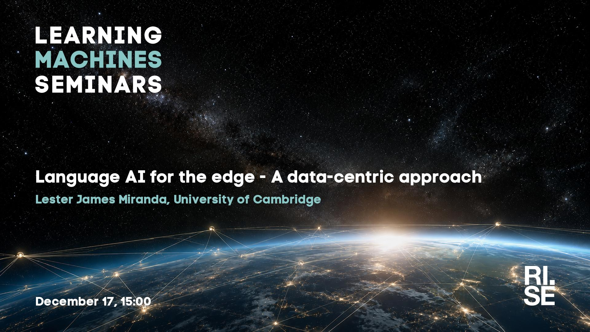

 
Welcome to this week's Learning Machines seminar.

**Title:** Language AI for the edge - A data-centric approach

**Speaker:** Lester James Miranda, University of Cambridge

**Abstract:** The prevailing recipe for building language models is that bigger is better: more data, more parameters, and more compute. Although this paradigm has produced remarkable frontier models that we use today, there is still a large gap in who benefits from them. This is true especially in much of the Global South, as Language AI deployment requires models that understand languages beyond English and run on small devices with limited connectivity. In this talk, I will discuss approaches to building language models for this setting, with a focus on data.

Specifically, I will focus on improving synthetic data generation for scaling multilingual data. Synthetic data has become a common way to scale up training data across languages, but it comes with its own problems. I will first present Polyglot Teachers, where we propose a metric that combines data quality and downstream model performance, and use it to prescribe a recipe for multilingual synthetic data generation. Then, I will discuss DataSmith, which combines long-standing approaches to multilingual dataset construction with the agentic capabilities of modern language models. Finally, I will share preliminary findings on making the data generation pipeline more efficient, along with future work on evaluating models on the edge. More broadly, I hope this talk offers a different perspective on progress in language models, measured not only by what the largest models can do, but by who can actually use them.

**About the speaker:** Lester James V. Miranda is a PhD student at the University of Cambridge’s Language Technology Laboratory, working with Anna Korhonen on equitable, multilingual natural language processing. His research focuses on building small, specialized, and cost-effective language models for edge deployment, particularly for underserved communities and Filipino NLP, with publications at top-tier venues including ACL, EMNLP, and NAACL. Prior to his PhD, he spent over seven years in industry and research, including roles as a predoctoral researcher at the Allen Institute for AI (Ai2), an open-source engineer working on spaCy and Prodigy at Explosion, a technology consultant in the Philippines, and a bioinformatics researcher studying protein function prediction. Outside of research, he enjoys photography and indie game development.

**Location:** This is an online seminar. Connect using Zoom.

**Date:** 2026-12-17 15:00

**[Register here!](https://form.apsis.one/gFgzLNf9ucK)**

**Upcoming seminars:**

* 2027-01-14: Maria Perez Ortiz, University College London
* 2027-01-28: Nicola Messina, ISTI-CNR
* 2027-03-11: Emanuele Rossi, Sapienza University, Rome
* 2027-03-18: Hao Wei, Technical University of Munich (TUM)
* All seminars are 15:00 CET.

More information and coming seminars: [https://learningmachines.se](https://learningmachines.se)

-- The Learning Machines Team

**Zoom link:** [https://rise.zoom.us/j/67564688191?pwd=5L78L9hBcVPOL0TqgjhBDqZYx2VPxD.1](https://rise.zoom.us/j/67564688191?pwd=5L78L9hBcVPOL0TqgjhBDqZYx2VPxD.1)

