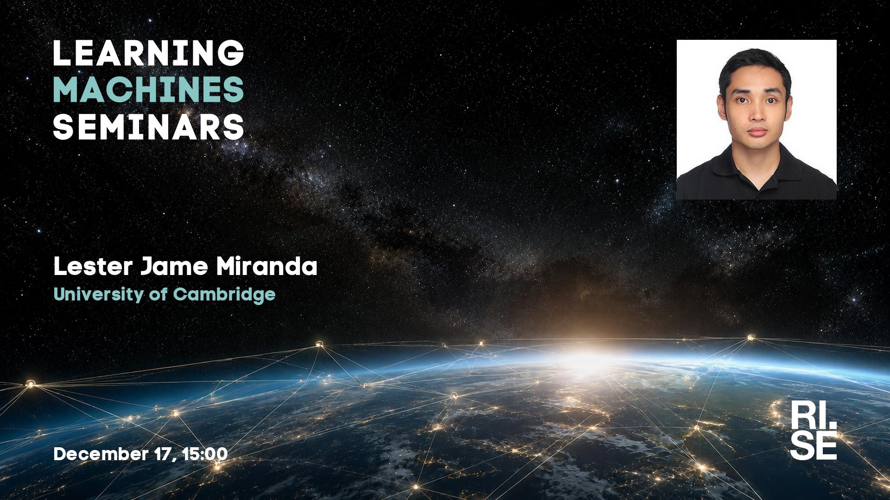

 
Welcome to this week's Learning Machines seminar.

**Title:** N/A

**Speaker:** Lester Jame Miranda, University of Cambridge

**Abstract:** N/A

**About the speaker:** Lester James V. Miranda is a PhD student at the University of Cambridge’s Language Technology Laboratory, working with Anna Korhonen on equitable, multilingual natural language processing. His research focuses on building small, specialized, and cost-effective language models for edge deployment, particularly for underserved communities and Filipino NLP, with publications at top-tier venues including ACL, EMNLP, and NAACL. Prior to his PhD, he spent over seven years in industry and research, including roles as a predoctoral researcher at the Allen Institute for AI (Ai2), an open-source engineer working on spaCy and Prodigy at Explosion, a technology consultant in the Philippines, and a bioinformatics researcher studying protein function prediction. Outside of research, he enjoys photography and indie game development.

**Location:** This is an online seminar. Connect using Zoom.

**Date:** 2026-12-17 15:00

**[Register here!](https://form.apsis.one/gFgzLNf9ucK)**

**Upcoming seminars:**

* 2027-01-14: Maria Perez Ortiz, University College London
* 2027-01-28: Nicola Messina, ISTI-CNR
* 2027-03-11: Emanuele Rossi, Sapienza University, Rome
* 2027-03-18: Hao Wei, Technical University of Munich (TUM)
* All seminars are 15:00 CET.

More information and coming seminars: [https://learningmachines.se](https://learningmachines.se)

-- The Learning Machines Team

**Zoom link:** [https://rise.zoom.us/j/67564688191?pwd=5L78L9hBcVPOL0TqgjhBDqZYx2VPxD.1](https://rise.zoom.us/j/67564688191?pwd=5L78L9hBcVPOL0TqgjhBDqZYx2VPxD.1)

