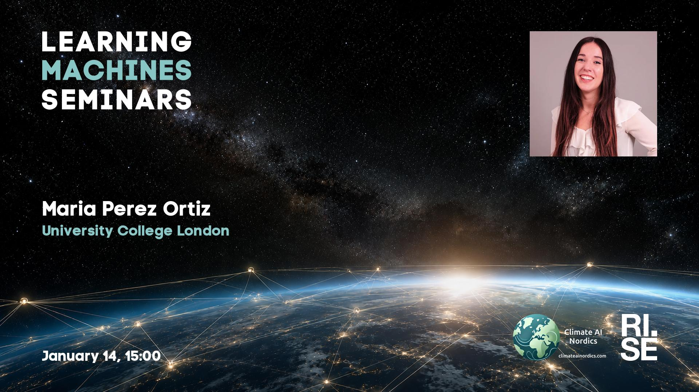

 
Welcome to this week's Learning Machines seminar.

This seminar is a collaboration between RISE and Climate AI Nordics -- [climateainordics.com](https://climateainordics.com/).

**Title:** N/A

**Speaker:** Maria Perez Ortiz, University College London

**Abstract:** N/A

**About the speaker:** Dr Perez-Ortiz is Associate Professor of Artificial Intelligence for Sustainable Development at the Department of Computer Science at University College London. Previously Perez-Ortiz was Lecturer and Senior Research Fellow at UCL and Research Associate at the University of Cambridge. Perez-Ortiz started working on AI technologies for sustainable development before the United Nations set the 2030 SDG Agenda in 2015. Her contributions on the development and real-world deployment of AI technologies in this field have had cascading impacts in areas as diverse as biomedicine (organ transplantation, skin cancer and human visual deficiencies), environmental sustainability (climate change, renewable energies and sustainable agriculture) and educational technology. Now, the focus of both her research and teaching revolve around the technological foundations for AI technology to truly support sustainable development, i.e. taking advantage of the profound possibilities of these technologies, for example for enabling the integration of renewable energy in the grid, or supporting climate action, while minimising the risks associated (unfair technology that discriminates against the most vulnerable, technologies that are easily attacked, etc.).

**Location:** This is an online seminar. Connect using Zoom.

**Date:** 2027-01-14 15:00

**Upcoming seminars:**

* 2027-01-28: Nicola Messina, ISTI-CNR
* 2027-03-11: Emanuele Rossi, Sapienza University, Rome
* 2027-03-18: Hao Wei, Technical University of Munich (TUM)
* All seminars are 15:00 CET.

More information and coming seminars: [https://learningmachines.se](https://learningmachines.se)

-- The Learning Machines Team

**Zoom link:** [https://rise.zoom.us/j/62207309827?pwd=w2QukPZCQG6rwCT7kNgVN9755wY1ai.1](https://rise.zoom.us/j/62207309827?pwd=w2QukPZCQG6rwCT7kNgVN9755wY1ai.1)

