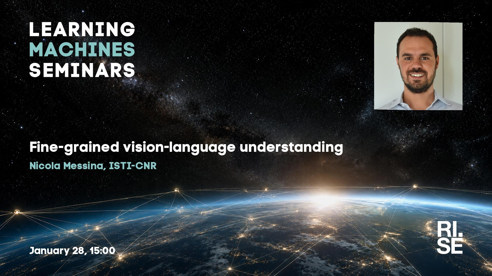

 
Welcome to this week's Learning Machines seminar.

**Title:** A journey through fine-grained vision-language understanding under limited supervision

**Speaker:** Nicola Messina, ISTI-CNR

**Abstract:** Recent vision-language models (VLMs) have demonstrated remarkable capabilities in capturing global visual semantics, yet they often struggle to understand fine-grained details. This is especially true in scenarios where we lack fine-grained training data, and we have to rely on weakly-supervised methodologies. This talk will be devoted to the exploration of the different dimensions of &quot;fine-grained&quot; perception: from the semantic nuances (i.e., distinguishing a wooden chair from a plastic one) up to spatial awareness, where the model should be able to effectively embed meaningful information from specific spatial locations in the image. I will address these topics by traversing different downstream tasks which require fine-grained spatial and semantic abilities, from fine-grained open-vocabulary object detection to zero-shot segmentation and zero-shot image captioning. Within this talk, I will examine the current limitations of large-scale pretrained models like CLIP in solving such problems, and I will propose possible solutions ranging from specialized benchmarks and datasets to novel architectures. The proposed approaches aim to address the &quot;blind spots&quot; of current models through targeted fine-tuning of existing multimodal backbones or by leveraging recent promising self-supervised vision models, paving the way towards more generalizable and data-efficient methods.

**About the speaker:** Nicola Messina is a researcher at the Artificial Intelligence for Media and Humanities (AIMH) laboratory at ISTI-CNR in Pisa, Italy. He received his Ph.D. in Information Engineering from the University of Pisa in 2022. His research focuses on the analysis and development of vision-language models, with applications to large-scale multimodal data exploration, cultural heritage preservation, and environmental monitoring. He is currently interested in foundational research challenges in fine-grained visual understanding and weakly supervised multimodal learning. He is also a member of the development team behind VISIONE, an interactive large-scale video retrieval system featuring advanced AI-driven search and browsing tools. His work has been published in top venues like CVPR (Highlight paper in 2024), ICCV, and WACV. In 2024, he received the ERCIM Cor Baayen Early Career Researcher Award.

**Location:** This is an online seminar. Connect using Zoom.

**Date:** 2027-01-28 15:00

**Upcoming seminars:**

* 2027-03-11: Emanuele Rossi, Sapienza University, Rome
* 2027-03-18: Hao Wei, Technical University of Munich (TUM)
* All seminars are 15:00 CET.

More information and coming seminars: [https://learningmachines.se](https://learningmachines.se)

-- The Learning Machines Team

**Zoom link:** [https://rise.zoom.us/j/62207309827?pwd=1C09em4rQYXW7ZtmP7YiFhS13Ji3OB.1](https://rise.zoom.us/j/62207309827?pwd=1C09em4rQYXW7ZtmP7YiFhS13Ji3OB.1)

