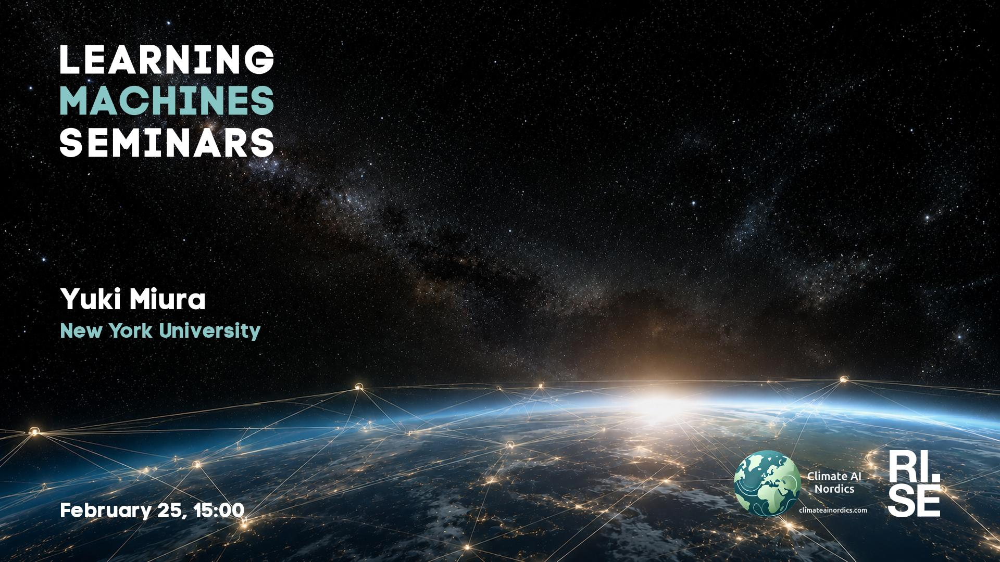

 
Welcome to this week's Learning Machines seminar.

This seminar is a collaboration between RISE and Climate AI Nordics -- [climateainordics.com](https://climateainordics.com/).

**Title:** N/A

**Speaker:** Yuki Miura, New York University

**Abstract:** N/A

**About the speaker:** N/A

**Location:** This is an online seminar. Connect using Zoom.

**Date:** 2027-02-25 15:00

**Upcoming seminars:**

* 2027-03-18: Hao Wei, Technical University of Munich (TUM)
* All seminars are 15:00 CET.

More information and coming seminars: [https://learningmachines.se](https://learningmachines.se)

-- The Learning Machines Team

**Zoom link:** [https://rise.zoom.us/j/62207309827?pwd=EFMNPpquIaVeX2GhiLX96BZRbmAy8W.1](https://rise.zoom.us/j/62207309827?pwd=EFMNPpquIaVeX2GhiLX96BZRbmAy8W.1)

