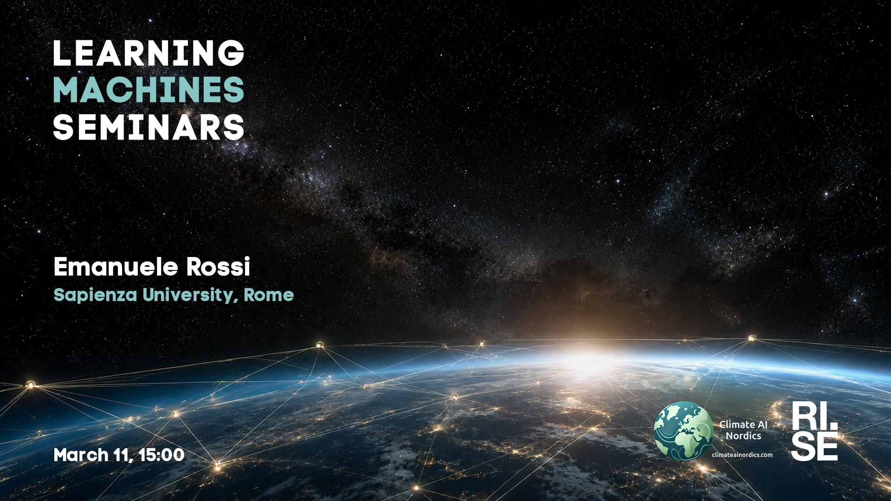

 
Welcome to this week's Learning Machines seminar.

This seminar is a collaboration between RISE and Climate AI Nordics -- [climateainordics.com](https://climateainordics.com/).

**Title:** N/A

**Speaker:** Emanuele Rossi, Sapienza University, Rome

**Abstract:** N/A

**About the speaker:** Emanuele Rossi is a postdoctoral researcher in the Gladia group at Sapienza University of Rome, working with Emanuele Rodolà. His research explores how machine learning, particularly multimodal models and mechanistic interpretability, can decode wild animal communication, shedding light on animal intelligence, consciousness, and humanity&#x27;s relationship with the natural world. His recent work includes OpenWhistle, the largest open dataset of dolphin whistles (accepted as a NeurIPS 2026 Spotlight). Prior to focusing on bioacoustics and animal communication, he developed generative models for structural biology and drug discovery at Vant AI and worked at Fabula AI, a deep learning startup for fake news detection later acquired by Twitter. He earned his PhD in Graph Neural Networks between Imperial College London and Twitter under the supervision of Michael Bronstein, and holds computer science degrees from Imperial College London and the University of Cambridge. Outside of research, he enjoys scuba diving and hiking.

**Location:** This is an online seminar. Connect using Zoom.

**Date:** 2027-03-11 15:00

**Upcoming seminars:**

* 2027-03-18: Hao Wei, Technical University of Munich (TUM)
* All seminars are 15:00 CET.

More information and coming seminars: [https://learningmachines.se](https://learningmachines.se)

-- The Learning Machines Team

**Zoom link:** [https://rise.zoom.us/j/62207309827?pwd=YK0la75HoXTb0PNUGZFE50IEraPRYX.1](https://rise.zoom.us/j/62207309827?pwd=YK0la75HoXTb0PNUGZFE50IEraPRYX.1)

