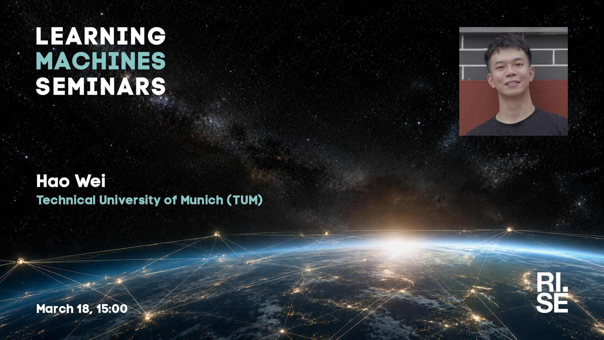

 
Welcome to this week's Learning Machines seminar.

**Title:** N/A

**Speaker:** Hao Wei, Technical University of Munich (TUM)

**Abstract:** N/A

**About the speaker:** Hao Wei is a PhD candidate in the Department of Biomedical Engineering at The Chinese University of Hong Kong (CUHK), where he is supervised by Prof. Scott Yuan at ABILab. His research focuses on medical image analysis, semi-supervised learning, domain generalization, and multimodal foundation models for healthcare. Prior to joining CUHK, he earned both his BS and MS in Computer Science and Technology from Central South University in China and completed research internships at Shanghai United Imaging Intelligence and The Chinese University of Hong Kong (Shenzhen).

**Location:** This is an online seminar. Connect using Zoom.

**Date:** 2027-03-18 15:00

**Upcoming seminars:**

* All seminars are 15:00 CET.

More information and coming seminars: [https://learningmachines.se](https://learningmachines.se)

-- The Learning Machines Team

**Zoom link:** [https://rise.zoom.us/j/62207309827?pwd=M033UKeaIUTuLhT2a5G10DQX84wpz9.1](https://rise.zoom.us/j/62207309827?pwd=M033UKeaIUTuLhT2a5G10DQX84wpz9.1)

